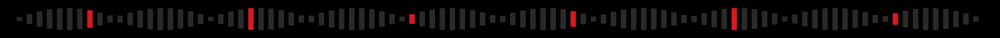

<!--
  GitHub profile README for github.com/Adityasiig

  Visual direction: a live SIP console. Pure black, one red (#d71921),
  mono type, real SMIL animation — camo preserves it, verified by
  probe rather than assumed.

  The body is four generated panels rather than markdown code blocks,
  so the whole page shares one visual language instead of a styled
  header sitting on top of plain text.

  Every panel is legible with animation disabled — see assets/profile.
  Regenerate:  cd assets/profile && python3 hero.py && python3 body.py
-->

  <a href="https://adityasiig.github.io/Portfolio/"><b>PORTFOLIO</b></a>
  &nbsp;·&nbsp;
  <a href="https://linkedin.com/in/singhaditya70"><b>LINKEDIN</b></a>
  &nbsp;·&nbsp;
  <a href="mailto:adityaajaysingh0104@gmail.com"><b>EMAIL</b></a>
  &nbsp;·&nbsp;
  <a href="https://portal.easedial.com"><b>EASEDIAL ↗</b></a>

  <a href="https://github.com/Adityasiig/cdr-direct"><b>MyCDR</b></a>
  &nbsp;·&nbsp;
  <a href="https://github.com/Adityasiig/easedial-portal"><b>EaseDial</b></a>
  <a href="https://portal.easedial.com">↗</a>
  &nbsp;·&nbsp;
  <a href="https://github.com/Adityasiig/routeforge-lcr2"><b>RouteForge LCR2</b></a>
  &nbsp;·&nbsp;
  <a href="https://github.com/Adityasiig/health-tracker"><b>Health Tracker</b></a>
  <a href="https://health-tracker-five-xi.vercel.app">↗</a>

  <a href="https://github.com/Adityasiig/glyph-radar"><b>Glyph Toys</b></a>
  &nbsp;·&nbsp;
  <a href="https://github.com/Adityasiig/Zero-Trust-Network-Access"><b>Zero Trust Network Access</b></a>
  &nbsp;·&nbsp;
  <a href="https://github.com/Adityasiig/WebVulnScanner"><b>WebVulnScanner</b></a>
  &nbsp;·&nbsp;
  <a href="https://github.com/Adityasiig/gotham-portfolio"><b>Gotham</b></a>
  &nbsp;·&nbsp;
  <a href="https://github.com/Adityasiig/terminal-portfolio"><b>Terminal</b></a>

> Security work here is for authorized engagements, defensive research,
> bug-bounty scopes and controlled labs.

  <b>BUILD CAREFULLY · OPERATE HONESTLY · IMPROVE CONTINUOUSLY</b> 
  Open to conversations about telecom infrastructure, production engineering and security. 
  <a href="mailto:adityaajaysingh0104@gmail.com"><b>Start a conversation →</b></a>

