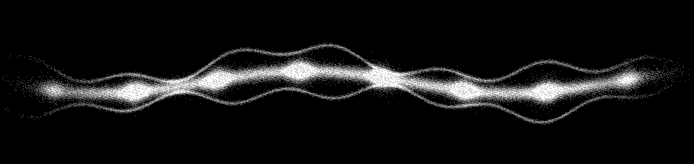

<!--
  github.com/Adityasiig

  Centred sections, emoji headings, badge rows, repo pins.
  banner.png is generated — see assets/profile/banner.py.

  No contribution-stats widgets: the stats/streak/top-langs cards and
  the activity graph were deliberately removed. Everything shown is
  work, not activity metrics.

  Remaining widgets are third-party services, each checked live before
  use. See assets/profile/README.md for which hosts are safe.
-->

<h1 align="center">Hi 👋, I'm Aditya Singh</h1>

<h3 align="center">Telecom DevOps Engineer</h3>

<code>SIP · Softswitches · CDR Analytics</code>

Building and operating carrier voice infrastructure — and the analytics
that tell you whether any of it is actually working.

  

---

## 🚀 About Me

🔭 &nbsp;Telecom DevOps Engineer at **Crown IT Solution**, where I started
as a VoIP NOC Engineer in August 2025.

📡 &nbsp;I run around **82 production servers** — mostly **OpenSIPS** and
**FreeSWITCH**, plus the routing and rate decks behind them.

📊 &nbsp;I build **CDR ingestion and margin analytics**: the pipelines that
turn raw call records into trunk quality, cost and revenue.

🔐 &nbsp;I also do **authorized security testing** — web, API, network and
VoIP.

🧩 &nbsp;For fun I write things like **Glyph Toys**, twelve animations for a
13×13 LED matrix, where a circle lands on 8, 12, 16, 32, 28, 40 pixels and
nothing curved survives.

 

---

## 🤝 Connect

  
  
  
  

---

## 💻 Tech Stack

  

  

  
  
  
  
  
  
  
  
  
  

---

## 🛠️ Projects

  
  

  
  

---

## 🔬 Lab

**[Glyph Toys](https://github.com/Adityasiig/glyph-radar)** — twelve
animations for the Nothing Phone's 13×13 Glyph Matrix. A circle of radius
*r* on that grid lands on 8, 12, 16, 32, 28, 40 pixels — not even
monotonic — so every design is built from what the grid renders exactly.

**[Zero Trust Network Access](https://github.com/Adityasiig/Zero-Trust-Network-Access)**
— experimental ZTNA with post-quantum crypto and live trust scoring.

**[WebVulnScanner](https://github.com/Adityasiig/WebVulnScanner)** — recon,
WAF detection, vulnerability checks and HTML reporting.

Security work here is for authorized engagements, defensive research,
bug-bounty scopes and controlled labs.

---

  <b>Build carefully · Operate honestly · Improve continuously</b>

  <a href="mailto:adityaajaysingh0104@gmail.com"><b>Start a conversation →</b></a>

