<!-- Profile of Aditya Ajay Singh · github.com/Adityasiig -->

  <picture>
    <source media="(max-width: 600px)" srcset="./github-profile-assets/flow/hero-mobile.png" />
    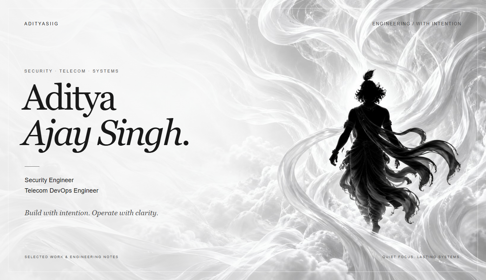
  </picture>

  <a href="https://adityasiig.github.io/Portfolio/"><b>Portfolio ↗</b></a>
  &nbsp;&nbsp; / &nbsp;&nbsp;
  <a href="https://linkedin.com/in/singhaditya70"><b>LinkedIn ↗</b></a>
  &nbsp;&nbsp; / &nbsp;&nbsp;
  <a href="mailto:adityaajaysingh0104@gmail.com"><b>Say hello ↗</b></a>

 

<picture>
  <source media="(max-width: 600px)" srcset="./github-profile-assets/flow/section-practice-mobile.svg" />
  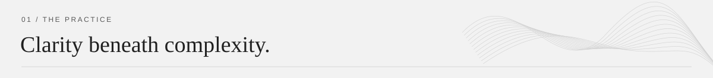
</picture>

I’m **Aditya Ajay Singh**, a **Security Engineer and Telecom DevOps Engineer**. I build the systems behind the signal: infrastructure that carries calls, tools that make operations clearer, and software that helps people get work done.

At **Crown IT Solution**, I’ve grown from VoIP NOC Engineer to Telecom DevOps Engineer since joining in **August 2025**. My work spans an **82+ server production fleet**, SIP routing, Linux automation, CDR analytics, and carrier operations. I stay involved after deployment: observing, troubleshooting, and improving what runs.

 

**01 / Infrastructure — Keep the signal moving.** 
SIP routing, softswitch deployment, fleet operations, and repeatable automation for real telecom environments.

**02 / Security — Understand the edges.** 
Web, API, network, and VoIP testing. Turn findings into reproducible evidence and practical improvements.

**03 / Software — Make complexity usable.** 
Backend services, data pipelines, and considered interfaces that bring operational work into focus.

 

<picture>
  <source media="(max-width: 600px)" srcset="./github-profile-assets/flow/section-work-mobile.svg" />
  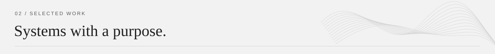
</picture>

A selection of the platforms, deployment tools, and experiments I work on.

<table>
<tr>
<td width="50%" valign="top">

<a href="https://github.com/Adityasiig/cdr-direct">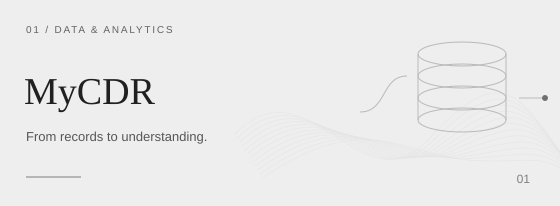</a>

### MyCDR / CDR Direct

CDR ingestion and analytics for NPANXX traffic, trunks, call quality, revenue, cost, and margin. Built for protected data nodes and production dashboards.

PYTHON · FLASK · DUCKDB · DOCKER

[Explore the project ↗](https://github.com/Adityasiig/cdr-direct)

</td>
<td width="50%" valign="top">

<a href="https://github.com/Adityasiig/easedial-portal">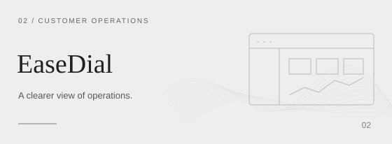</a>

### EaseDial Customer Portal

A carrier portal that brings tenant-scoped access, KPIs, CDR diagnostics, rates, invoices, exports, and transaction history into one operational interface.

TYPESCRIPT · NEXT.JS · REST APIs

[Source ↗](https://github.com/Adityasiig/easedial-portal) &nbsp; / &nbsp; [Visit portal ↗](https://portal.easedial.com)

</td>
</tr>
<tr>
<td width="50%" valign="top">

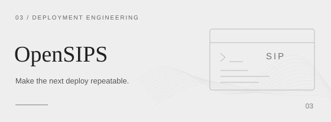

### OpenSIPS Deploy

Docker-packaged tooling for repeatable OpenSIPS installation, upgrades, and standalone deployments through a controlled, bundle-driven workflow.

OPENSIPS · PHP · BASH · DOCKER

Deployment engineering / Telecom infrastructure

</td>
<td width="50%" valign="top">

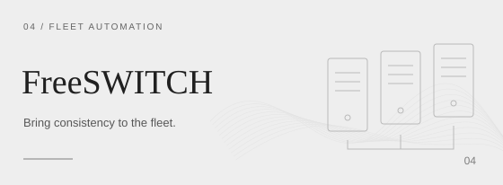

### FreeSWITCH Deploy System

Repeatable server provisioning and configuration workflows that reduce manual setup and configuration drift across telecom environments.

FREESWITCH · LINUX · BASH · AUTOMATION

Deployment engineering / Fleet operations

</td>
</tr>
<tr>
<td width="50%" valign="top">

<a href="https://github.com/Adityasiig/routeforge-lcr2">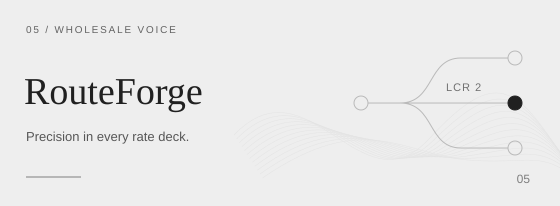</a>

### RouteForge LCR2

Rate-deck tooling for NPANXX pricing and second-lowest-cost routing workflows, shaped by the day-to-day needs of wholesale voice operations.

TYPESCRIPT · NPANXX · LEAST-COST ROUTING

[Explore the project ↗](https://github.com/Adityasiig/routeforge-lcr2)

</td>
<td width="50%" valign="top">

<a href="https://github.com/Adityasiig/health-tracker">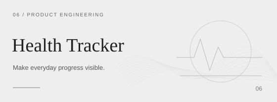</a>

### Health Tracker

A full-stack platform for nutrition, hydration, weight, body metrics, food discovery, analytics, and AI-assisted coaching.

NEXT.JS · TYPESCRIPT · SUPABASE · AI

[Source ↗](https://github.com/Adityasiig/health-tracker) &nbsp; / &nbsp; [Try it live ↗](https://health-tracker-five-xi.vercel.app)

</td>
</tr>
</table>

 

<picture>
  <source media="(max-width: 600px)" srcset="./github-profile-assets/flow/section-systems-mobile.svg" />
  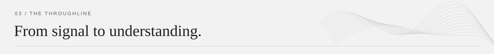
</picture>

The work connects: route the traffic, operate the infrastructure, understand the records, and put useful information in people’s hands.

<picture>
  <source media="(max-width: 600px)" srcset="./github-profile-assets/flow/systems-map-mobile.svg" />
  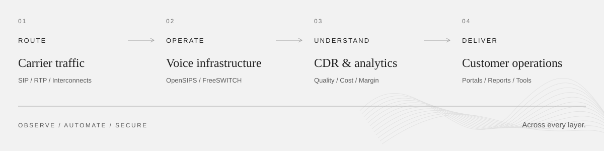
</picture>

Read the system flow

1. **Route:** carrier traffic, SIP, RTP, and interconnects.
2. **Operate:** OpenSIPS, FreeSWITCH, Linux, and Docker.
3. **Understand:** CDR ingestion, analytics, quality, and margin.
4. **Deliver:** customer portals, reports, and operational tools.

Observability, automation, and security connect the entire system.

 

<picture>
  <source media="(max-width: 600px)" srcset="./github-profile-assets/flow/section-toolkit-mobile.svg" />
  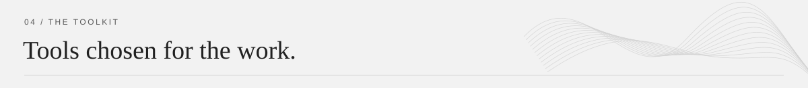
</picture>

| Area | Tools & technologies |
|:--|:--|
| **Telecom** | OpenSIPS · FreeSWITCH · VOS3000 · SIP · RTP · LCR · CDR |
| **Infrastructure** | Linux · Docker · Coolify · Caddy · Cloudflare · SSH · Git |
| **Backend & data** | Python · FastAPI · Flask · PostgreSQL · ClickHouse · DuckDB · MySQL · Kafka |
| **Interfaces** | TypeScript · Next.js · React · JavaScript · HTML · CSS |
| **Observability** | Grafana · fleet probes · service health monitoring · ClickHouse analytics |
| **Security** | Nmap · Burp Suite · Ghidra · gdb · ltrace · web, API & VoIP testing |

 

<picture>
  <source media="(max-width: 600px)" srcset="./github-profile-assets/flow/section-experiments-mobile.svg" />
  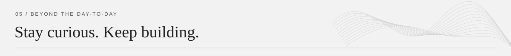
</picture>

- [**WebVulnScanner ↗**](https://github.com/Adityasiig/WebVulnScanner) — reconnaissance, WAF detection, vulnerability checks, and HTML reporting.
- [**Zero Trust Network Access ↗**](https://github.com/Adityasiig/Zero-Trust-Network-Access) — an experimental ZTNA system exploring post-quantum cryptography and real-time trust scoring.
- [**Gotham Portfolio ↗**](https://github.com/Adityasiig/gotham-portfolio) — a cinematic Next.js portfolio with motion-driven interaction.
- [**Terminal Portfolio ↗**](https://github.com/Adityasiig/terminal-portfolio) — a terminal-inspired portfolio built with React and TypeScript.
- [**Glyph Toys ↗**](https://github.com/Adityasiig/glyph-radar) — twelve animations for a 13×13 LED matrix, built with Java and Android. Validated in simulation; not yet tested on physical hardware.

Security projects are for authorized engagements, defensive research, bug-bounty scopes, and controlled labs.

 
 

<a href="mailto:adityaajaysingh0104@gmail.com">
  <picture>
    <source media="(max-width: 600px)" srcset="./github-profile-assets/flow/footer-mobile.svg" />
    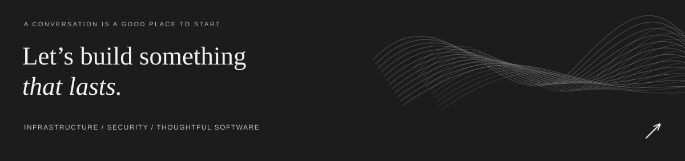
  </picture>
</a>

   
  <a href="mailto:adityaajaysingh0104@gmail.com"><b>Start a conversation ↗</b></a>
  &nbsp;&nbsp; / &nbsp;&nbsp;
  <a href="https://linkedin.com/in/singhaditya70">LinkedIn</a>
  &nbsp;&nbsp; / &nbsp;&nbsp;
  <a href="https://adityasiig.github.io/Portfolio/">Portfolio</a>
    
  ADITYA AJAY SINGH &nbsp; / &nbsp; BUILD WITH INTENTION.

