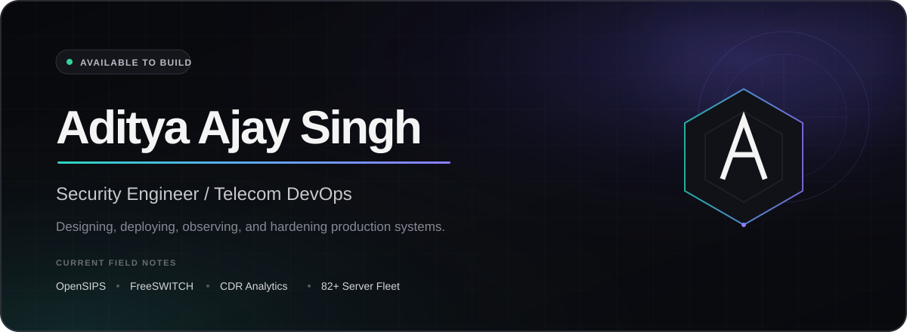
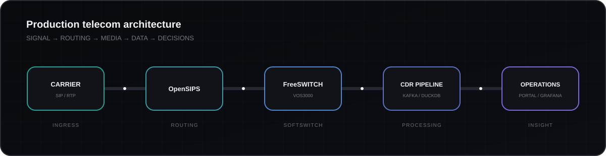

<!--
  GitHub profile README for github.com/Adityasiig
  Visual direction: restrained, editorial, infrastructure-led.
-->

  

  <a href="https://adityasiig.github.io/Portfolio/"><b>Portfolio</b></a>
  &nbsp;&nbsp;·&nbsp;&nbsp;
  <a href="https://linkedin.com/in/singhaditya70"><b>LinkedIn</b></a>
  &nbsp;&nbsp;·&nbsp;&nbsp;
  <a href="mailto:adityaajaysingh0104@gmail.com"><b>Email</b></a>

 

## Engineering systems that stay useful after launch.

I am a **Security Engineer and Telecom DevOps Engineer** working across VoIP infrastructure, offensive security, backend systems, and production observability. I take systems from design to deployment—then operate, measure, and harden them.

Since joining **Crown IT Solution** in August 2025, I progressed from VoIP NOC Engineer to Telecom DevOps Engineer. My current work spans **OpenSIPS, FreeSWITCH, VOS3000, Linux automation, CDR analytics, carrier reporting, and an 82+ server production fleet**.

 

<table>
<tr>
<td width="33%" valign="top">

### Telecom infrastructure

SIP routing, softswitch deployment, fleet operations, troubleshooting, LCR workflows, and production automation.

 

</td>
<td width="33%" valign="top">

### Security engineering

Authorized web, API, network, and VoIP testing—from reconnaissance and validation to evidence and reporting.

 

</td>
<td width="33%" valign="top">

### Product engineering

Operational platforms built with Python, TypeScript, FastAPI, Next.js, PostgreSQL, ClickHouse, and Docker.

 

</td>
</tr>
</table>

 

## Selected work

<table>
<tr>
<td width="50%" valign="top">

### [MyCDR / CDR Direct](https://github.com/Adityasiig/cdr-direct)

Telecom CDR ingestion and analytics for NPANXX traffic, trunks, quality, revenue, cost, and margin. Designed for protected data nodes and production dashboard deployment.

`Python` &nbsp; `Flask` &nbsp; `DuckDB` &nbsp; `Docker`

 

</td>
<td width="50%" valign="top">

### [EaseDial Customer Portal](https://github.com/Adityasiig/easedial-portal) · [Live ↗](https://portal.easedial.com)

Production carrier portal with tenant-scoped access, operational KPIs, CDR diagnostics, relationship reports, rates, invoices, exports, and transaction history.

`TypeScript` &nbsp; `Next.js` &nbsp; `REST APIs`

 

</td>
</tr>
<tr>
<td width="50%" valign="top">

### OpenSIPS Deploy

Docker-packaged deployment tooling for repeatable OpenSIPS installation, upgrades, and standalone deployments using a controlled, bundle-driven workflow.

`OpenSIPS` &nbsp; `PHP` &nbsp; `Bash` &nbsp; `Docker`

 

</td>
<td width="50%" valign="top">

### FreeSWITCH Deploy System

Repeatable server provisioning and configuration workflows that reduce manual setup and configuration drift across telecom environments.

`FreeSWITCH` &nbsp; `Linux` &nbsp; `Bash` &nbsp; `Automation`

 

</td>
</tr>
<tr>
<td width="50%" valign="top">

### [RouteForge LCR2](https://github.com/Adityasiig/routeforge-lcr2)

Telecom rate-deck tooling for NPANXX pricing and second-lowest-cost routing workflows, built around practical wholesale voice operations.

`TypeScript` &nbsp; `NPANXX` &nbsp; `LCR`

 

</td>
<td width="50%" valign="top">

### [Health Tracker](https://github.com/Adityasiig/health-tracker) · [Live ↗](https://health-tracker-five-xi.vercel.app)

Full-stack health platform for nutrition, hydration, weight, body metrics, analytics, food discovery, and AI-assisted coaching.

`Next.js` &nbsp; `TypeScript` &nbsp; `Supabase` &nbsp; `AI`

 

</td>
</tr>
</table>

 

## From signal to insight

  

 

## Tools I reach for

| Domain | Technologies |
|:--|:--|
| **Telecom** | OpenSIPS · FreeSWITCH · VOS3000 · SIP · RTP · LCR · CDR |
| **Infrastructure** | Linux · Docker · Coolify · Caddy · Cloudflare · SSH · Git-based deployments |
| **Backend & data** | Python · FastAPI · Flask · PostgreSQL · ClickHouse · DuckDB · MySQL · Kafka |
| **Frontend** | TypeScript · Next.js · React · JavaScript · HTML · CSS |
| **Observability** | Grafana · ClickHouse analytics · fleet probes · service health monitoring |
| **Security** | Nmap · Burp Suite · Ghidra · gdb · ltrace · web/API/VoIP testing |

 

## More experiments

- [**WebVulnScanner**](https://github.com/Adityasiig/WebVulnScanner) — reconnaissance, WAF detection, vulnerability checks, and HTML reporting.
- [**Zero Trust Network Access**](https://github.com/Adityasiig/Zero-Trust-Network-Access) — experimental ZTNA system using post-quantum cryptography and real-time trust scoring.
- [**Gotham Portfolio**](https://github.com/Adityasiig/gotham-portfolio) — a cinematic Next.js portfolio with motion-driven interaction.
- [**Terminal Portfolio**](https://github.com/Adityasiig/terminal-portfolio) — a terminal-inspired portfolio built with React and TypeScript.

 

> Security work shown here is intended for authorized engagements, defensive research, bug-bounty scopes, and controlled lab environments.

   
  <h3>Build carefully. Operate honestly. Improve continuously.</h3>
  
Open to thoughtful conversations about telecom infrastructure, production engineering, and security.

  

    <a href="mailto:adityaajaysingh0104@gmail.com"><b>Start a conversation →</b></a>
  

   
  

