<!--
  github.com/Adityasiig

  Minimal. Two SVGs (a header and a hairline), the rest is plain
  Markdown so it stays readable, greppable and easy to edit.

  Regenerate assets:  cd assets/profile && python3 minimal.py
-->



I build and operate telecom infrastructure — SIP routing, softswitches, and
the analytics that tell you whether any of it is actually working.

Telecom DevOps Engineer at **Crown IT Solution**, where I started as a VoIP
NOC Engineer in August 2025. Around 82 production servers, mostly OpenSIPS
and FreeSWITCH.


### Work

**[MyCDR](https://github.com/Adityasiig/cdr-direct)** — CDR ingestion and
analytics: NPANXX traffic, trunks, quality, revenue, cost, margin.
<sub>Python · Flask · DuckDB</sub>

**[EaseDial Portal](https://github.com/Adityasiig/easedial-portal)** —
carrier portal with tenant-scoped access, KPIs, CDR diagnostics, rates and
invoices. <sub>TypeScript · Next.js</sub> ·
[live](https://portal.easedial.com)

**[RouteForge LCR2](https://github.com/Adityasiig/routeforge-lcr2)** —
rate-deck tooling for NPANXX pricing and second-lowest-cost routing.
<sub>TypeScript · LCR</sub>

**[Health Tracker](https://github.com/Adityasiig/health-tracker)** —
nutrition, hydration and body metrics with analytics and coaching.
<sub>Next.js · Supabase</sub> ·
[live](https://health-tracker-five-xi.vercel.app)

### Stack

```
Telecom    OpenSIPS · FreeSWITCH · VOS3000 · SIP · RTP · LCR · CDR
Infra      Linux · Docker · Coolify · Caddy · Cloudflare
Backend    Python · FastAPI · Flask · PostgreSQL · ClickHouse · DuckDB
Frontend   TypeScript · Next.js · React
Security   Nmap · Burp Suite · Ghidra · gdb · web / API / VoIP testing
```

### Lab

**[Glyph Toys](https://github.com/Adityasiig/glyph-radar)** — twelve
animations for the Nothing Phone's 13×13 Glyph Matrix. A circle of radius
*r* on that grid lands on 8, 12, 16, 32, 28, 40 pixels — not even
monotonic — so every design is built from what the grid renders exactly
rather than from curves sampled onto it.

**[Zero Trust Network Access](https://github.com/Adityasiig/Zero-Trust-Network-Access)**
— experimental ZTNA with post-quantum crypto and live trust scoring.

**[WebVulnScanner](https://github.com/Adityasiig/WebVulnScanner)** — recon,
WAF detection, vulnerability checks, HTML reporting.

<sub>Security work here is for authorized engagements, defensive research,
bug-bounty scopes and controlled labs.</sub>


[Portfolio](https://adityasiig.github.io/Portfolio/) ·
[LinkedIn](https://linkedin.com/in/singhaditya70) ·
[Email](mailto:adityaajaysingh0104@gmail.com)
