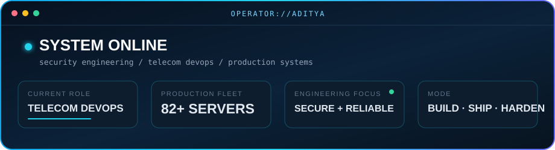
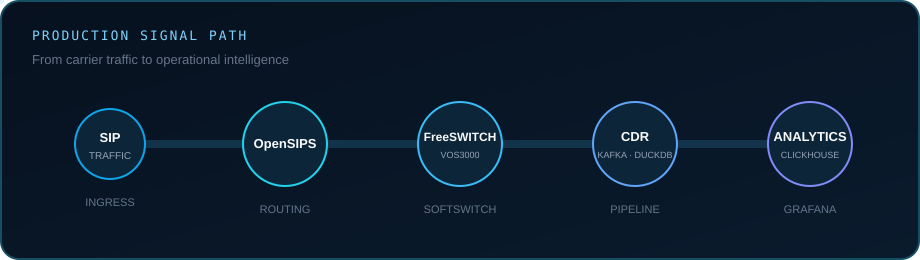

<!-- GitHub profile README for github.com/Adityasiig -->

<div align="center">


[](https://adityasiig.github.io/gotham-portfolio/)
[](https://linkedin.com/in/singhaditya70)
[](mailto:adityaajaysingh0104@gmail.com)
[](https://github.com/Adityasiig)

</div>

<div align="center">
  
</div>

## 01 // Operator profile

I am a **Security Engineer and Telecom DevOps Engineer** who designs, deploys, secures, and maintains production systems end to end. My work sits at the intersection of **offensive security, VoIP infrastructure, backend engineering, and observability**.

- Working at **Crown IT Solution** since August 2025; progressed from **VoIP NOC Engineer** to **Telecom DevOps Engineer**.
- Operating and automating infrastructure built around **OpenSIPS, FreeSWITCH, VOS3000, SIP, and Linux**.
- Building production tools for **CDR analytics, billing, fleet monitoring, least-cost routing, and customer reporting**.
- Conducting security work only in **authorized engagements, labs, and bug-bounty scopes**.
- Completed a **Bachelor of Science in Information Technology** in Q1 2026.

<div align="center">


</div>

## 02 // Production signal path

<div align="center">
  
</div>

## 03 // Systems shipped

| Project | What it does | Core stack |
|---|---|---|
| [**MyCDR / CDR Direct**](https://github.com/Adityasiig/cdr-direct) | Ingests hourly telecom CDR files and provides authenticated analytics for NPANXX traffic, trunks, quality, revenue, cost, and margin. | Python, Flask, DuckDB, Docker |
| [**EaseDial Customer Portal**](https://github.com/Adityasiig/easedial-portal) · [Live](https://portal.easedial.com) | Production customer portal with tenant-scoped access, carrier KPIs, reports, CDR diagnostics, rates, invoices, and transaction history. | TypeScript, Next.js, APIs |
| [**RouteForge LCR2**](https://github.com/Adityasiig/routeforge-lcr2) | Telecom rate-deck tooling for NPANXX pricing and second-lowest-cost routing workflows. | TypeScript, Telecom Rating |
| **OpenSIPS Deploy** | Docker-packaged deployment interface supporting repeatable OpenSIPS installation, upgrades, and standalone deployments. | PHP, Bash, Docker, OpenSIPS |
| **FreeSWITCH Deploy System** | Repeatable server provisioning and configuration workflows designed to reduce manual setup and configuration drift. | Bash, Linux, FreeSWITCH |
| [**Health Tracker**](https://github.com/Adityasiig/health-tracker) · [Live](https://health-tracker-five-xi.vercel.app) | Full-stack health platform for nutrition, hydration, weight, body metrics, analytics, food search, and AI-assisted coaching. | Next.js, TypeScript, Supabase, AI |

<details>
<summary><strong>More engineering and security projects</strong></summary>
<br />

- [**WebVulnScanner**](https://github.com/Adityasiig/WebVulnScanner) — modular security scanner with reconnaissance, WAF detection, vulnerability checks, and HTML reports.
- [**Zero Trust Network Access**](https://github.com/Adityasiig/Zero-Trust-Network-Access) — experimental ZTNA dashboard using post-quantum cryptography and real-time trust scoring.
- [**Gotham Portfolio**](https://github.com/Adityasiig/gotham-portfolio) — dark interactive portfolio built with Next.js and motion-driven UI.
- [**Terminal Portfolio**](https://github.com/Adityasiig/terminal-portfolio) — terminal-inspired portfolio experience built with React and TypeScript.

</details>

## 04 // Technical stack

**Telecom and infrastructure**


**Backend, data, and observability**


**Application and security engineering**


## 05 // Operating model

```text
RECON  ->  DESIGN  ->  BUILD  ->  DEPLOY  ->  OBSERVE  ->  HARDEN

Current focus:
  - Telecom platform automation and reliability
  - CDR billing, analytics, and carrier reporting
  - Authorized web, API, network, and VoIP security testing
  - Production tools that operators can trust at 3 AM
```

> **Security note:** Repositories and write-ups related to security are intended for authorized testing, defensive research, and controlled lab environments.

<div align="center">

### Have a telecom, infrastructure, or security problem worth solving?

[](mailto:adityaajaysingh0104@gmail.com)

<sub>Security engineering · Telecom DevOps · Production systems</sub>


</div>
