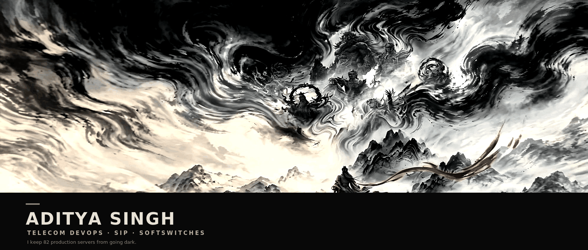
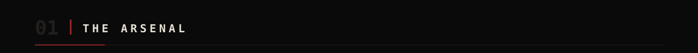
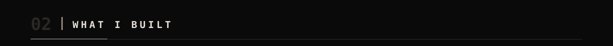
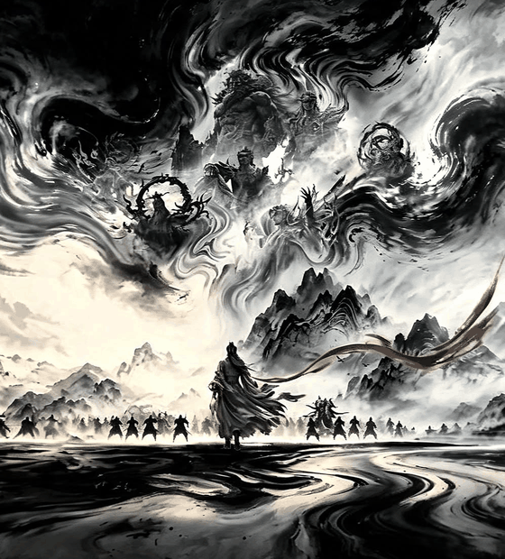
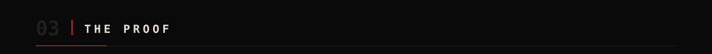
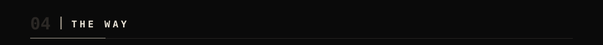

<!--
  github.com/Adityasiig

  Sumi-e theme, built from the ink-wash painting in assets/profile.
  Palette taken from the artwork, not invented:
    ink #0a0a0a · paper #e8e2d6 · blood #8e2429 (the ribbon)

  Rule borrowed from the painting: ONE accent per view. The ribbon reads
  because everything around it is monochrome. Do not add a second colour.

  Kanji appears only in Markdown text, never in a generated image — the
  build container has no CJK font, so a rasterised glyph becomes tofu.

  Regenerate: cd assets/profile && python3 sumi.py
-->

  <b>墨</b>&nbsp;&nbsp;One brush. One accent. Everything else is restraint.

  
  
  
  
  
  
  

  

  

  I pick boring tools on purpose. They are still running at 3am,
  which is the only review that counts.

<table>
<tr><td width="58%" valign="top">

**[MyCDR](https://github.com/Adityasiig/cdr-direct)** — turns raw call
records into trunk quality, cost and margin. Carriers argue about money
with numbers; this is where the numbers come from.
`Python` `Flask` `DuckDB`

**[EaseDial Portal](https://github.com/Adityasiig/easedial-portal)** —
tenant-scoped, so a customer sees their traffic and nobody else's. That
boundary is the whole product. `TypeScript` `Next.js` ·
[live](https://portal.easedial.com)

**[RouteForge LCR2](https://github.com/Adityasiig/routeforge-lcr2)** —
prices NPANXX and picks second-lowest-cost routes, because wholesale
voice is not won by being cheapest. `TypeScript` `LCR`

**[Glyph Toys](https://github.com/Adityasiig/glyph-radar)** — twelve
animations for a 13×13 LED matrix. A circle of radius *r* there lands on
8, 12, 16, 32, 28, 40 pixels — not even monotonic. So I stopped drawing
circles and built from what the grid renders exactly.
`Java` `Android`

</td><td width="42%" valign="top">

</td></tr>
</table>

| | |
|---|---|
| **82** | production servers I keep alive |
| **Aug 2025** | VoIP NOC Engineer → Telecom DevOps |
| **OpenSIPS · FreeSWITCH** | what the routing actually runs on |
| **ClickHouse · DuckDB** | where the call records land |
| **Authorized only** | web, API, network and VoIP testing |

  
  

> **道** — I do not guess. Every claim here was measured before it was
> written.
>
> **証** — If I have not run it, I do not say it works.
>
> **静** — Fewer moving parts beats a clever architecture.

> **Where I am still wrong:** Glyph Toys has never run on real hardware —
> I do not own the phone. Every check is simulation. I am saying so here
> rather than letting you find out.

  
  
  
  

  Security work here is for authorized engagements, defensive
  research, bug-bounty scopes and controlled labs.

