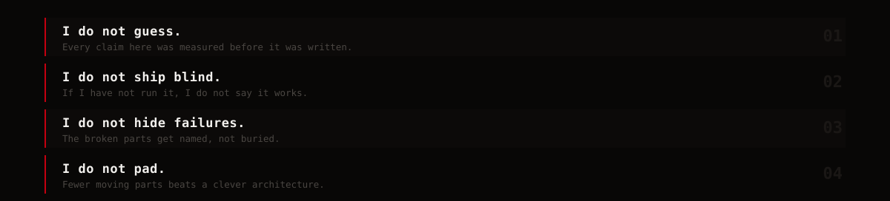
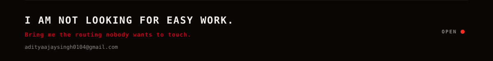

<!--
  github.com/Adityasiig

  Dark egoist theme. Blood red (#c30010) on near-black (#080706),
  first-person and declarative. Assets generated by assets/profile/ego.py.

  The voice is the point: short, certain sentences. Keep it specific —
  numbers and named systems — or it reads as noise instead of confidence.

  No contribution-stats widgets. Work, not activity metrics.
-->

  
  
  
  
  
  
  

  

  

  <b>I pick boring tools on purpose.</b> They are still running at
  3am, which is the only review that counts.

  
  

  
  

**MyCDR** turns raw call records into trunk quality, cost and margin.
Carriers argue about money with numbers; this is where the numbers come
from.

**EaseDial Portal** is tenant-scoped, so a customer sees their traffic and
nobody else's. That boundary is the whole product.

**RouteForge LCR2** prices NPANXX and picks second-lowest-cost routes,
because wholesale voice is not actually won by being cheapest.

**Glyph Toys** is twelve animations for a 13×13 LED matrix. A circle of
radius *r* there lands on 8, 12, 16, 32, 28, 40 pixels — not even
monotonic. So I stopped drawing circles and built from what the grid
renders exactly. **I measured it before I redesigned it.**

| | |
|---|---|
| **82** | production servers I keep alive |
| **Aug 2025** | VoIP NOC Engineer → Telecom DevOps |
| **OpenSIPS · FreeSWITCH** | what the routing actually runs on |
| **ClickHouse · DuckDB** | where the call records land |
| **Authorized only** | web, API, network and VoIP testing |

> **Where I am still wrong:** Glyph Toys has never run on real hardware —
> I do not own the phone. Every check is simulation. I am saying so here
> rather than letting you find out.

  
  
  
  

  Security work here is for authorized engagements, defensive
  research, bug-bounty scopes and controlled labs. The ego stops at the
  scope boundary.

