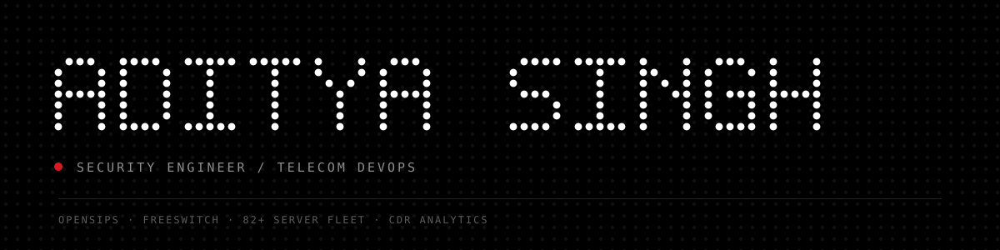

<!--
  GitHub profile README for github.com/Adityasiig

  Visual direction: dot matrix, pure black, one red accent (#d71921).
  Deliberately the same language as the portfolio and the Glyph Matrix
  toys, so the three properties read as one person's work.

  Assets in assets/profile are generated; see that folder's note.
-->

  <a href="https://adityasiig.github.io/Portfolio/">Portfolio</a> ·
  <a href="https://linkedin.com/in/singhaditya70">LinkedIn</a> ·
  <a href="mailto:adityaajaysingh0104@gmail.com">Email</a>

I build and operate telecom infrastructure — SIP routing, softswitches,
and the analytics that tell you whether any of it is actually working.
Currently Telecom DevOps Engineer at **Crown IT Solution**, where I
started as a VoIP NOC Engineer in August 2025.

Day to day that means OpenSIPS and FreeSWITCH, an 82+ server production
fleet, CDR pipelines, carrier reporting, and the Linux automation that
keeps all of it repeatable. I also do authorized security testing across
web, API, network and VoIP surfaces.

**Telecom DevOps Engineer · Crown IT Solution** — since Aug 2025

Softswitch deployment and SIP routing · fleet operations across 82+
servers · CDR ingestion and margin analytics · LCR and rate-deck
workflows · carrier reporting · provisioning automation

**[MyCDR / CDR Direct](https://github.com/Adityasiig/cdr-direct)**
`Python` `Flask` `DuckDB` `Docker`
CDR ingestion and analytics for NPANXX traffic, trunks, quality, revenue,
cost and margin. Built for protected data nodes and production dashboards.

**[EaseDial Customer Portal](https://github.com/Adityasiig/easedial-portal)** · [live ↗](https://portal.easedial.com)
`TypeScript` `Next.js` `REST`
Carrier portal with tenant-scoped access, operational KPIs, CDR
diagnostics, rates, invoices, exports and transaction history.

**[RouteForge LCR2](https://github.com/Adityasiig/routeforge-lcr2)**
`TypeScript` `NPANXX` `LCR`
Rate-deck tooling for NPANXX pricing and second-lowest-cost routing,
built around how wholesale voice actually gets priced.

**[Health Tracker](https://github.com/Adityasiig/health-tracker)** · [live ↗](https://health-tracker-five-xi.vercel.app)
`Next.js` `TypeScript` `Supabase`
Nutrition, hydration, weight and body metrics with analytics, food
discovery and AI-assisted coaching.

| | |
|:--|:--|
| **Telecom** | OpenSIPS · FreeSWITCH · VOS3000 · SIP · RTP · LCR · CDR |
| **Infrastructure** | Linux · Docker · Coolify · Caddy · Cloudflare · Git-based deploys |
| **Backend & data** | Python · FastAPI · Flask · PostgreSQL · ClickHouse · DuckDB · Kafka |
| **Frontend** | TypeScript · Next.js · React |
| **Observability** | Grafana · ClickHouse analytics · fleet probes · health monitoring |
| **Security** | Nmap · Burp Suite · Ghidra · gdb · web/API/VoIP testing |

Things I built because I wanted to know whether they would work.

- **[Glyph Toys](https://github.com/Adityasiig/glyph-radar)** — twelve
  animations for the Nothing Phone's 13×13 Glyph Matrix, drawn for that
  grid rather than scaled down to it.
- **[WebVulnScanner](https://github.com/Adityasiig/WebVulnScanner)** —
  recon, WAF detection, vulnerability checks and HTML reporting.
- **[Zero Trust Network Access](https://github.com/Adityasiig/Zero-Trust-Network-Access)**
  — experimental ZTNA with post-quantum crypto and live trust scoring.
- **[Gotham](https://github.com/Adityasiig/gotham-portfolio)** ·
  **[Terminal](https://github.com/Adityasiig/terminal-portfolio)** — two
  portfolios that went in very different directions.

> Security work here is for authorized engagements, defensive research,
> bug-bounty scopes and controlled labs.

  Open to conversations about telecom infrastructure, production
  engineering and security —
  <a href="mailto:adityaajaysingh0104@gmail.com">get in touch</a>.

